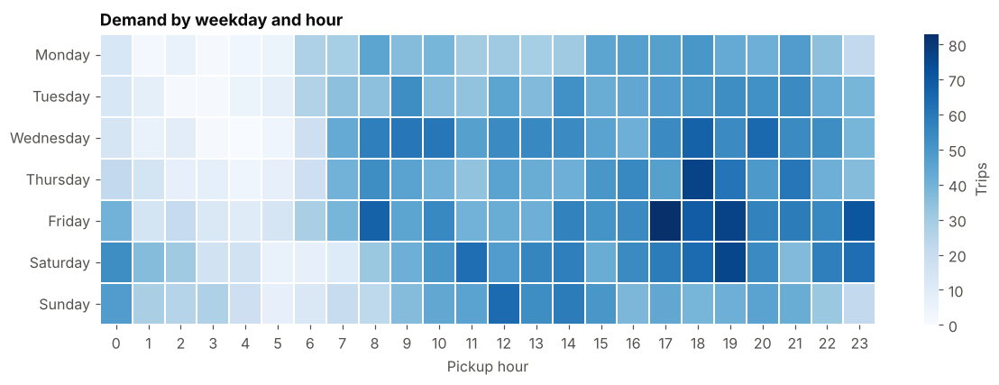
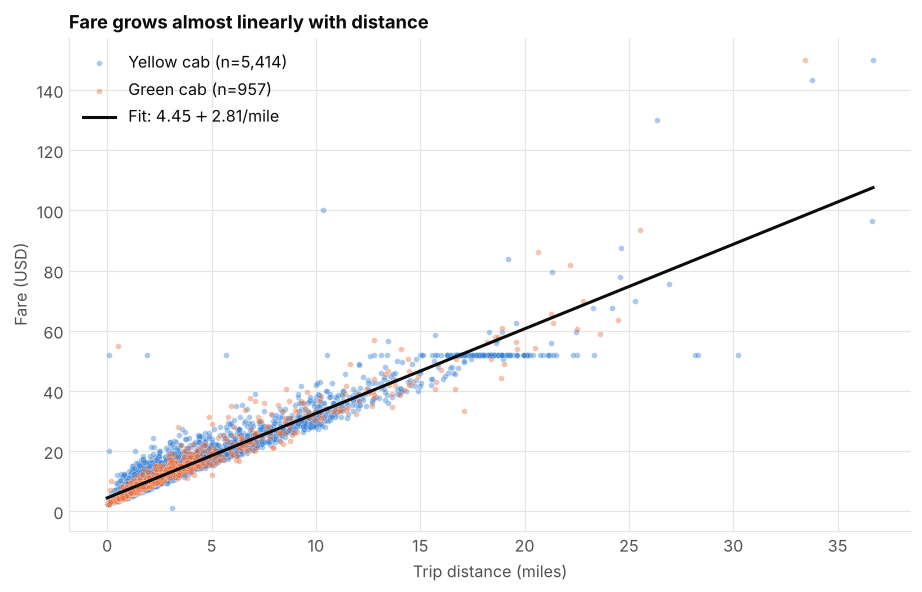
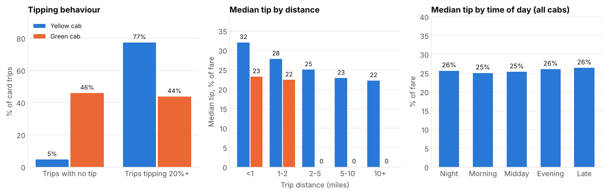

# NYC Taxi Trips, March 2019: Demand, Fares and Tipping

| | |
|---|---|
| **Author** | Manindra Shukla |
| **GitHub** | [Manindra07](https://github.com/Manindra07) |
| **Email** | manindrashukla77@gmail.com |
| **Purpose** | Yuva Intern Project |

Exploratory data analysis of 6,433 real New York City taxi trips (NYC Taxi & Limousine Commission records, sample from [seaborn-data](https://github.com/mwaskom/seaborn-data)). The project covers dataset selection, exploration, cleaning, analysis with Pandas, NumPy and SciPy, 21 visualisations, and written findings and recommendations.

**Main file:** [`NYC_Taxi_Analysis.ipynb`](NYC_Taxi_Analysis.ipynb) (already executed, so GitHub shows all charts).
A standalone, mobile-friendly report is in `NYC_Taxi_Analysis.html` (download it and open in a browser).

## Key findings

- **Demand:** 82% of pickups are in Manhattan; demand peaks at 6 pm and Friday 5-7 pm is the busiest window.
- **Fares:** about $4.45 + $2.81 per mile; distance explains 92% of fare differences. 126 trips cost exactly $52 (JFK flat fare).
- **Tipping:** 46% of green-cab card trips record no tip, against 5% for yellow cabs. Cash tips are never recorded.
- **Data quality:** 62 of 6,433 rows (1%) were removed as impossible records.





## Project structure

| Path | What it is |
|---|---|
| `NYC_Taxi_Analysis.ipynb` | The analysis: explore, clean, analyse, visualise, conclude |
| `NYC_Taxi_Analysis.html` | The same report as a responsive web page |
| `data/taxis.csv` | Raw dataset |
| `output/taxis_clean.csv` | Cleaned dataset produced by the notebook |
| `build_notebook.py`, `build_html.py`, `insights.md`, `takeaways.py` | Scripts and text used to generate the notebook and HTML |
| `images/` | Charts shown in this README |

## Run it

```bash
pip install -r requirements.txt
jupyter notebook NYC_Taxi_Analysis.ipynb
```

Run all cells from the top. To rebuild the notebook and HTML from the scripts:

```bash
python build_notebook.py
jupyter nbconvert --to notebook --execute --inplace NYC_Taxi_Analysis.ipynb
python build_html.py
```

## Method and limits

- Outliers were investigated and kept: long trips cost less per mile, which is the pattern of real airport and long-haul rides.
- Fares and distances are right-skewed, so medians and rank-based tests (Mann-Whitney, Kruskal-Wallis, Spearman) are used.
- One month and about 6,400 trips: patterns and ratios are more reliable than totals. Findings show association, not cause.
